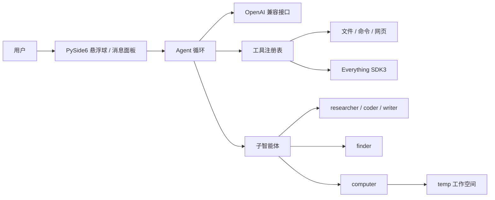

<div align="center">

# Desktop Bot · 桌面 AI 悬浮球

**点一下悬浮球，让 AI 在桌面上帮你做事。**

一个运行在 Windows 桌面的轻量 AI 助手：流式对话、Markdown、语音输入、工具调用、可扩展子智能体，
以及 Everything 本地文件检索和电脑操作能力。

[](https://www.python.org/)
[](https://doc.qt.io/qtforpython/)
[](#)
[](LICENSE)
[](https://github.com/moyulyy/desktop-bot)

[项目地址](https://github.com/moyulyy/desktop-bot) · [快速开始](#-快速开始) · [功能](#-功能亮点) · [子智能体](#-子智能体) · [架构](#-架构)

</div>

---

## 这是什么？

Desktop Bot 是一个常驻桌面的 AI 悬浮球。它不像传统聊天窗口那样占据屏幕，而是把对话、
工具和任务进度收进一个可拖动、会自动吸附边缘的小球里：

```text
┌──────────────────────────────────────────┐
│  ●  在线 · deepseek-flash        ⚙  ▢  ⌄ │
│                                          │
│  你：帮我找一下上周的预算表               │
│                                          │
│  AI：我在本地找到了 3 个相关文件……        │
│      ▸ 工具调用 · 4 项 · 已折叠           │
│                                          │
│  ┌────────────────────────────────────┐  │
│  │ 输入消息…                    🎙  ↑ │  │
│  └────────────────────────────────────┘  │
└──────────────────────────────────────────┘
                         ●
```

它适合这些场景：

- 快速问答、写作、翻译和代码解释；
- 让 AI 读取/修改本地项目文件；
- 在磁盘上按文件名或内容检索资料；
- 截屏并执行基础鼠标/键盘操作；
- 把检索、编码、写作等任务交给独立上下文的子智能体。

## ✨ 功能亮点

| 能力 | 说明 |
| --- | --- |
| 🫧 悬浮球交互 | 点按展开，拖动移动，自动吸附屏幕边缘；不会出现在任务栏或 Alt+Tab |
| ⚡ 流式回复 | SSE 逐字输出；生成时发送键变为停止键，停止立即生效 |
| 🧠 可扩展 Agent | 工具注册、权限审批、hooks、`task` 子智能体委派 |
| 🧰 工具调用卡片 | 工具与子任务进度合并为可折叠卡片，运行时显示旋转等待环 |
| 🖼️ Markdown | 标题、列表、代码块、链接、本地/远程图片，支持拖选复制 |
| 🎙️ 语音输入 | 腾讯云一句话识别，录音后转为文字 |
| 🔎 Everything 检索 | 基于 Everything 1.5 SDK3，支持文件名、扩展名和内容搜索 |
| 🖱️ 电脑操作 | 截图、鼠标、键盘、窗口切换、打开应用，工作空间保存临时文件 |
| 🗂️ 本地知识库 | 分类保存 PDF、HTML/URL、图片/截图、密码、Markdown、脚本，并支持全文检索 |
| 📚 论文 RAG | 论文/HTML 分块、本地 embedding、FTS+向量混合检索，中文/英文和页码引用 |
| 🧾 代码片段 | `database/code/` 保存带语言、描述、标签的代码并参与检索 |
| 🌐 浏览器报表 | 长表格/复杂结果生成 HTML，含图片、可点击引用、代码块和打印样式 |
| 🧩 选择气泡 | 需求不明确时用按钮让用户选择，点击后继续任务 |
| 🔐 本地优先 | API Key 只保存在本机配置文件；工具操作按权限模式审批 |
| 🪟 静默启动 | `start.vbs` 使用 `pythonw`，无黑色控制台；单实例运行 |
| 🎨 双主题 | 跟随系统 / 浅色 / 深色，玻璃质感卡片与柔光悬浮球 |

## 🚀 快速开始

### 方式一：一键启动（推荐）

1. 安装 [Python 3.10+](https://www.python.org/downloads/windows/)；
2. 克隆仓库：

   ```bash
   git clone https://github.com/moyulyy/desktop-bot.git
   cd desktop-bot
   ```

3. 双击 **`run.bat`**，首次会自动安装依赖并启动；
4. 之后日常双击 **`start.vbs`**（可发送到桌面作为快捷方式）。它会优先使用
   `desktop-rag` conda 环境中的 `pythonw.exe`，找不到时回退到系统 Python；通过
   `pythonw.exe` 静默运行，不会出现黑色控制台窗口。若本机存在
   `Umi-OCR_Paddle_v2.0.0/Umi-OCR.exe`，还会同时启动 Umi-OCR 并设置
   `UMI_OCR_URL`（默认 `http://127.0.0.1:1224`）。

> `run.bat` 只在首次安装/修复依赖时需要。程序为单实例，重复启动会安静退出。
> 如果静默启动异常，查看 `temp/app_error.log`。

### 方式二：命令行

```bash
python -m pip install -r requirements.txt
python -m pip install -e .

# 直接运行
python -m desktop_assistant

# 或使用安装后的入口
desktop-assistant
```

不安装为包时也可以：

```bash
PYTHONPATH=src python -m desktop_assistant
```

### 配置模型

首次启动是**本地模式**，只能做简单问答。右键悬浮球 → **设置 → 模型**，填写：

- API Key
- Base URL（兼容 OpenAI `/chat/completions`）
- 模型名

支持 DeepSeek、OpenAI、DashScope 等兼容接口。设置页内置「测试连接」，
保存后立即热更新，不需要重启。

也可以直接编辑 `config/agent_config.json`（参考 `config/agent_config.example.json`）：

```json
{
  "api_key": "sk-...",
  "base_url": "https://api.deepseek.com",
  "model": "deepseek-chat",
  "temperature": 0.7,
  "max_tokens": 4096,
  "max_turns": 50,
  "permission_mode": "default",
  "stream": true,
  "workspace": "temp"
}
```

> `config/agent_config.json` 与 `config/asr_config.json` 已被 `.gitignore` 忽略，
> 不要把自己真实的密钥提交到仓库。

环境变量仍然优先：

| 变量 | 用途 |
| --- | --- |
| `OPENAI_API_KEY` | 模型 API Key |
| `OPENAI_BASE_URL` | 模型接口地址 |
| `OPENAI_MODEL` | 模型名称 |
| `AGENT_SYSTEM` | 覆盖系统提示词 |
| `TENCENT_SECRET_ID` / `TENCENT_SECRET_KEY` | 腾讯云语音识别密钥 |

## 🖱️ 交互

| 操作 | 效果 |
| --- | --- |
| 点按悬浮球 | 展开 / 收起面板 |
| 拖动悬浮球或面板标题栏 | 移动，松手后吸附屏幕边缘 |
| 拖动消息面板外角手柄 | 调整消息窗口宽高，自动记住 |
| `Enter` | 发送 |
| `Esc` | 停止生成；未在生成时收起面板 |
| `Ctrl+,` | 打开设置 |
| `Ctrl+Shift+H` | 显示 / 隐藏消息气泡 |
| 悬停悬浮球滚动滚轮 | 调节不透明度 |
| 点击工具卡片标题 | 展开 / 收起工具与子任务步骤 |
| 点击选择卡按钮 | 回答智能体的选项，继续任务 |
| 右键悬浮球 / 托盘图标 | 设置、外观、恢复消息窗大小、清空会话、退出 |

其他细节：

- 气泡隐藏时，新回复以横幅预览，悬浮球按钮显示未读角标；
- 空状态提供示例问题，点一下填入输入框；
- 消息支持 Markdown、拖选、`Ctrl+C` / `Ctrl+A`、右键复制；链接可点击；
- 图片可写本地绝对路径或 `http(s)` URL，远程图片会异步下载并缓存；
- 生成过程中可随时点击停止键，正在进行的 HTTP 请求和本地命令会一并取消。

## 🧩 子智能体

主智能体通过 `task` 工具把任务交给独立上下文的子智能体：

```json
{
  "agent": "researcher",
  "prompt": "查一下 PySide6 6.12 的发布说明并总结",
  "context": "用户在意界面性能"
}
```

子智能体拥有自己的系统提示、工具集、模型覆盖和轮数上限，完成后只把结论返回主智能体。
子智能体还可以继续委派，默认最大深度 2。`task` 本身不直接操作文件，真正的工具仍然逐个走权限校验。

内置角色（`subagents.items` 为空时自动使用）：

| 名称 | 用途 | 默认工具 |
| --- | --- | --- |
| `researcher` | 联网检索与事实核对 | `web_fetch`、`get_current_time`、`open_url` |
| `coder` | 阅读/修改代码、运行命令 | 文件读写、列目录、`run_shell` |
| `writer` | 整理中文文案 | `get_current_time` |
| `finder` | Everything 本地文件检索 | `search_files`、`read_file`、`list_directory` |
| `computer` | 屏幕截图、鼠标/键盘、窗口与应用操作 | `screen_capture`、`mouse_*`、`keyboard_*`、`focus_window`、`workspace_*` |
| `librarian` | 知识库整理：分类、描述、标签、索引、检索 | `database_*`、`vault_*`、`open_report`、文件读取 |
| `rag` | 论文/HTML 的 RAG 检索、导入与引用 | `rag_*`、`image_describe`、`open_report` |

### finder：Everything 本地检索

`finder` 使用项目自带的 Everything 1.5（`vendor/everything/`）和官方 SDK3 named-pipe DLL：

- `报告`：按文件名搜索；
- `ext:pdf 预算`：组合条件；
- `content:"Q3复盘"`：内容搜索（需在 Everything 中启用内容索引）；
- 首次检索会自动启动 Everything 并隐藏窗口，只读，不修改文件。

如果内容搜索没有结果，请在 Everything 的「工具 → 选项 → 内容」中开启内容索引。

### computer：电脑操作与临时工作空间

`computer` 子智能体可以：

- 截取整个虚拟桌面（支持多屏）；
- 移动、点击、拖动、滚动鼠标；
- 输入中文/Unicode 文本和组合键（`ctrl+s`、`alt+tab`、`win+r` 等）；
- 切换窗口、打开应用/文件/URL；
- 在临时工作空间里写并运行 Python 脚本。

截图和临时脚本默认保存在项目下的 `temp/`，**不会写到项目根目录**：

```text
temp/
  screenshots/   截图
  scripts/       临时 Python 脚本
  notes/         临时笔记
```

路径可在「设置 → 子智能体 → 工作空间」修改，保存在 `config/agent_config.json`
的 `workspace` 字段。`temp/` 已加入 `.gitignore`。

鼠标、键盘、截图、运行脚本等操作在默认权限模式下会请求授权，支持「允许一次」和
「总是允许」。涉及删除文件、关闭未保存文档、付款或关机时，子智能体被要求先确认。

### librarian：本地知识库

`librarian` 子智能体负责把资料整理进项目下的 `database/`（可被 `.gitignore` 忽略）：

```text
database/
  pdfs/           PDF 文档
  html/           HTML 文件
  urls/           URL 记录（urls.jsonl）
  images/         图片
  screenshots/    截图
  passwords/      密码保险库（Windows DPAPI 加密）
  markdown/       Markdown 笔记
  code/           代码片段（带语言/描述/标签）
  scripts/        脚本
  inbox/          待整理文件
  index.sqlite3   SQLite FTS5 索引
  catalog.json    文件路径、类型、描述、标签
  INDEX.md        可读目录
```

常用流程：

- 把文件放进 `database/inbox/`，让 librarian 分类、补描述和标签；
- 对 AI 说“把这份 PDF 整理进知识库”，它会调用 `database_add_file`；
- “查一下知识库里关于预算的资料”会调用 `database_search`；
- 网页地址用 `database_add_url` 记录；
- 密码用 `vault_add` 加密保存，`vault_list` 只返回服务名/用户名，绝不明文落盘；
- 整理后用 `database_reindex` 更新索引和 `INDEX.md`。

知识库路径可在「设置 → 子智能体 → 知识库目录」修改。索引使用 SQLite FTS5
（trigram，支持中文子串），不需要外部服务；设计上借鉴 gbrain 的“有来源、可纠正、
可检索”思路。密码库使用当前 Windows 用户的 DPAPI 加密，只在本机可用。

### 论文与 HTML RAG

`rag` 子智能体面向中文/英文论文和网页，默认按 1 万篇论文的规模设计：

- PDF：`pdfplumber` 提取版面与表格，`pypdf` 补充元数据和内嵌图片；
- HTML：优先 `trafilatura` 提取正文；URL 只在导入时抓取一次，原始 HTML 缓存到 `database/html/`；
- 分块：约 700 tokens、100 overlap，保留页码、章节和来源；
- Embedding：本地 `fastembed`，默认 `sentence-transformers/paraphrase-multilingual-MiniLM-L12-v2`；模型缓存默认 `models/`；
- 检索：SQLite FTS5 + 向量召回，RRF 融合，返回标题、路径/URL、页码和片段；
- 图片：PDF 内嵌图保存到 `database/images/papers/<doc-id>/`，提取图注、可选 OCR；
  `image_describe` 可查看图注/OCR，后续可接本地或远程多模态模型生成描述；
- 规模：`sqlite-vec` 可用时使用向量索引；未安装时退化为 SQLite 向量扫描（适合开发和小库）。

#### 安装与模型

```bash
conda create -n desktop-rag python=3.11
conda activate desktop-rag
python -m pip install -r requirements.txt -r requirements-rag.txt
```

首次 embedding 会下载多语言模型
`sentence-transformers/paraphrase-multilingual-MiniLM-L12-v2`（384 维，约 240 MB）
到 `models/`（已加入 `.gitignore`）。PDF/OCR 依赖是可选的；没有安装 `fastembed` 时
会回退到确定性的 `HashEmbedder`，便于离线测试，但不适合生产语义检索。

#### 添加论文/文本

在项目根目录执行：

```bash
# 单篇 PDF
PYTHONPATH=src python -m desktop_assistant.rag_cli ingest-pdf "D:\papers\paper.pdf"

# 单篇 txt / md
PYTHONPATH=src python -m desktop_assistant.rag_cli ingest-text "D:
otes
ote.md"

# 批量导入整个目录（PDF、HTML、txt、md）
PYTHONPATH=src python -m desktop_assistant.rag_cli ingest-dir database/papers

# URL 列表（JSONL：{"url": "...", "title": "..."}）；只在导入时抓取
PYTHONPATH=src python -m desktop_assistant.rag_cli ingest-urls database/urls/urls.jsonl

# 检索与统计
PYTHONPATH=src python -m desktop_assistant.rag_cli search "火星任务预算" --top-k 8
PYTHONPATH=src python -m desktop_assistant.rag_cli stats
```

也可以直接把 PDF 放进 `database/papers/`，然后在对话里让 `rag` 子智能体执行
`rag_ingest_pdf` 或 `rag_reindex`。重复导入会按源文件 SHA 跳过，10k 篇可以分批跑。

### 知识库入口、附件与定时整理

- 悬浮球右侧的 ✨ 按钮：选择多个文件，自动按后缀放入 `database/pdfs`、`images`、
  `screenshots`、`markdown`、`scripts` 等目录，并建立 RAG 索引。
- 输入框左侧的 ＋：添加文件、图片、截屏，或直接 `Ctrl+V` 粘贴图片/文件；
  附件先进入 `temp/chat/files/`，随消息记录到 `temp/chat/messages.jsonl`。
- 右键 →「立即更新 RAG 与知识库」：把临时附件/对话记录移入 database，跑完整整理，
  显示进度条，成功后关闭进度并清空对应 `temp/chat` 数据。
- 默认每天凌晨 **02:00**（应用运行时）自动整理一次；自动任务读取 `temp/` 和
  `database/`，写入仅限 `database/` 及其子路径。同一日期只运行一次；错过 02:00 时
  在 02:00–02:05 补跑。
- 手动「立即更新 RAG 与知识库」会立即处理 `temp/` 附件、迁移到 database，并在成功后
  清空对应的 `temp/chat` 临时数据。
- 知识库写入和整理路径都经过根目录校验，不会写到 database 之外。
- 仓库只提交 `database/README.md` 和各分类的 `.gitkeep`，不提交 PDF、图片、密码库、
  SQLite 索引或知识库笔记；详见 [`database/README.md`](database/README.md)。

### OCR：Umi-OCR / Tesseract

PDF 内嵌图片和附件图片支持 OCR。优先使用 [Umi-OCR](https://github.com/hiroi-sora/Umi-OCR)
的 HTTP API：

```powershell
# Umi-OCR 启动 HTTP 服务后设置（默认端口以 Umi-OCR 设置为准）
$env:UMI_OCR_URL = "http://127.0.0.1:1224"
```

#### Umi-OCR 安装与配置

Umi-OCR 不随仓库提交（体积大，按 Umi-OCR 自身许可证分发）。使用前：

1. 从 [Umi-OCR Releases](https://github.com/hiroi-sora/Umi-OCR/releases) 下载
   `Umi-OCR_Paddle_v2.0.0`（或 Rapid 版）；
2. 解压到项目根目录：
   ```text
   Umi-OCR_Paddle_v2.0.0/
     Umi-OCR.exe
     UmiOCR-data/
   ```
3. 启动一次 Umi-OCR，在「全局设置 → 服务」确认：
   ```text
   server.enable=true
   server.host=127.0.0.1
   server.port=1224
   ```
   默认配置已开启 HTTP 服务；
4. 关闭 Umi-OCR，之后双击 `start.vbs` 会自动启动它并设置：
   ```text
   UMI_OCR_URL=http://127.0.0.1:1224
   ```
5. 若放在其他目录，可修改 `start.vbs` 中的候选路径；若端口不同，先设置
   `$env:UMI_OCR_URL`。可访问以下地址确认服务：
   ```text
   http://127.0.0.1:1224/api/ocr/get_options
   ```

`ocr.py` 会依次尝试 Umi-OCR 的 `/api/ocr` 常见 base64 请求格式，并兼容
`data/text/ocr/result` 等响应结构；Umi-OCR 不可用时回退到本机 Tesseract
（`chi_sim+eng`），仍失败则保留图片和图注而不阻断入库。Tesseract 需要额外安装
程序及中文语言包。图片资产保存在 `database/images/papers/<doc-id>/`，
`image_describe` 可查看图注/OCR/描述。

### 浏览器报表

当结果包含宽表格、长清单或需要打印的分析时，智能体会调用 `open_report`：
它把 Markdown 排版成响应式 HTML（表格、代码块、打印样式），保存到
`temp/reports/` 并在默认浏览器打开。右键悬浮球 →「在浏览器打开当前对话」
也可以直接导出整段会话。`temp/` 已忽略，不会进入 Git。

### 自定义角色

在设置页「子智能体 → 新增」创建，或直接编辑配置：

```json
"subagents": {
  "enabled": true,
  "max_depth": 2,
  "items": [
    {
      "name": "summarizer",
      "description": "把长文本压缩成三条要点",
      "system": "你是严谨的中文编辑，只输出要点。",
      "tools": ["read_file"],
      "model": "",
      "max_turns": 3,
      "enabled": true
    }
  ]
}
```

`tools` 为空表示继承主智能体全部工具；`model` 为空表示使用主模型。

## 🧰 内置工具

| 工具 | 用途 |
| --- | --- |
| `get_current_time` | 当前日期时间 |
| `read_file` / `write_file` / `edit_file` | 读取、写入、精确替换文件 |
| `list_directory` | 列出目录 |
| `run_shell` | 执行命令；Windows 默认优先 Git Bash，可切换 `cmd` / `powershell` |
| `web_fetch` / `open_url` | 抓取网页文本 / 浏览器打开链接 |
| `search_files` | Everything 本地文件检索 |
| `ask_user` | 向用户提供按钮选项 |
| `screen_capture` / `screen_info` | 截屏 / 屏幕与活动窗口信息 |
| `mouse_move` / `mouse_click` / `mouse_scroll` / `mouse_drag` | 鼠标操作 |
| `keyboard_type` / `keyboard_press` | 键盘输入与组合键 |
| `focus_window` / `list_windows` | 窗口切换与枚举 |
| `open_app` | 打开应用、文件或 URL |
| `workspace_*` | 工作空间信息、写文件、列目录、运行 Python |
| `database_add_code` | 保存带语言、描述和标签的代码片段到 `database/code/` |

### 权限模式

| 模式 | 行为 |
| --- | --- |
| `default` | 只读/安全工具直接执行，危险工具弹窗询问 |
| `acceptEdits` | 文件编辑自动允许，其他危险操作仍询问 |
| `bypassPermissions` | 全部允许（请只在可信环境使用） |
| `plan` | 禁止执行修改类工具 |

## 🏗️ 架构



```text
src/desktop_assistant/
  app.py              悬浮球、消息面板、输入栏、拖拽动画、语音与设置接入
  agent_framework.py  Agent 循环、工具注册、权限、流式 SSE、task 委派
  config_store.py     配置默认值 / 校验 / 原子读写 / 环境变量覆盖
  ui_kit.py           主题、颜色工具、矢量图标、阴影与流光球
  settings_dialog.py  设置页与工具授权对话框
  everything_search.py Everything 1.5 SDK3 named-pipe 检索客户端
  computer_tools.py   截图、鼠标、键盘、窗口与工作空间工具
  local_subagents.py  内置子智能体装配
  database.py         知识库、SQLite FTS5 索引与目录导出
  database_tools.py   知识库/密码库/浏览器报告的 Agent 工具
  library_service.py  附件临时区、文件入库、每日/手动整理 Worker
  ocr.py              Umi-OCR HTTP API + Tesseract 回退
  password_vault.py   Windows DPAPI 加密密码保险库
  rag.py              论文/HTML 分块、embedding、混合检索、PDF/图片抽取
  reports.py          Markdown → 独立 HTML 浏览器报表
config/               agent_config.example.json、asr_config.example.json
vendor/everything/    Everything 1.5 便携版与 SDK3 DLL
database/             本地知识库；仓库只保留目录和 README，真实内容已忽略
tests/                框架 + 配置 + 离屏 UI 冒烟测试
temp/                 截图 / 临时脚本 / 临时笔记（已忽略）
start.vbs             无控制台静默启动器
run.bat               首次安装依赖并静默启动
pyproject.toml        src 布局、入口点与依赖声明
requirements-rag.txt  可选 PDF / HTML / embedding / 向量索引 / OCR 依赖
```

### 扩展点

- `Tool` / `ToolRegistry`：新增工具只需提供 JSON Schema 与 handler；
- `SubagentSpec` / `SubagentRegistry`：注册新的子智能体角色；
- `AgentOptions.on_event`：实时监听 `text_delta`、`tool_use`、`subagent_*` 事件；
- `AgentOptions.hooks`：`UserPromptSubmit` / `PreToolUse` / `PostToolUse` / `Stop`；
- `AgentOptions.ask_user`：把按钮选项交给界面，返回用户点击结果；
- `ChatCard.add_choice`：渲染带按钮的选择气泡；
- `permission_mode` + `can_use_tool`：替换权限策略；
- `computer_tools.build_computer_tools`：扩展桌面操作工具；
- `database.KnowledgeBase`：扩展知识库索引、分类与检索；
- `reports.open_report`：把任意 Markdown 导出为浏览器报表；
- `rag.build_rag_tools`：接入论文/HTML 的 RAG 检索与导入；
- `library_service.LibraryOrganizer`：扩展知识库整理/导入流程；
- `ocr.UmiOCR`：替换或扩展图片 OCR 后端；
- `everything_search.EverythingClient`：替换/扩展本地检索实现。

## 🧪 开发与测试

```bash
python -m pip install pytest
python -m pytest tests
```

测试使用离屏 Qt（`QT_QPA_PLATFORM=offscreen`），不会访问网络或写入真实配置；
覆盖 Agent 循环、流式工具调用、子智能体委派、配置校验、工具调用卡片、选择气泡、
窗口缩放、电脑工具工作空间等。

运行界面调试：

```bash
python -m desktop_assistant
```

## 🔐 安全与隐私

- API Key、语音密钥只保存在本机 `config/`，不会提交到 GitHub；
- 对话内容会发送到你自己配置的模型接口；
- 工具调用需要遵循权限模式；电脑操作可要求每次授权；
- 截图、临时脚本默认落在 `temp/`，已在 `.gitignore` 中忽略；
- 不要在不可信环境使用 `bypassPermissions`；
- 仓库不包含任何真实密钥或用户数据。

## ❓ FAQ

**Q：`run_shell` 为什么以前会失败？**
旧实现使用 Windows `cmd.exe`；Unix/Git Bash 命令（`ls`、`grep`、`find`）会失败。
现在默认检测 Git Bash，也支持 `shell=cmd` 和 `shell=powershell`。

**Q：为什么截图不在项目根目录？**
截图和临时脚本默认写入 `temp/screenshots/` 与 `temp/scripts/`；可在设置中修改工作空间。

**Q：悬浮球会出现在任务栏吗？**
不会。窗口使用 `Qt.Tool`，只保留系统托盘图标。

**Q：需要安装 Everything 吗？**
项目自带 Everything 1.5 便携版与 SDK3 DLL，`finder` 首次检索会自动启动；若需内容搜索，
请在 Everything 中开启内容索引。

## 📄 License

本项目使用 [MIT License](LICENSE)。

Copyright © 2026 lyy

## 🙏 致谢

- [PySide6](https://doc.qt.io/qtforpython/)：桌面 UI
- [Everything](https://www.voidtools.com/) 与 SDK3：本地文件检索
- 所有为这个项目提供建议、测试和反馈的人
